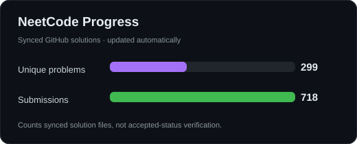

# Hey, I'm Khwaab Thareja 👋

### Software Engineer | AI Agents | Backend & Distributed Systems

Building AI systems, backend services, and occasionally breaking things along the way.

📍 New York City · 🎓 M.S. Computer Science, NYU Tandon

  

---

## 👨‍💻 A Little About Me

I'm a software engineer who enjoys building **AI agents, backend systems**, and figuring out why things break (and occasionally fixing them).

I've worked on **financial systems serving millions of users, distributed workflows, and AI applications**. Lately, I'm exploring how to make AI agents more reliable and useful.

---

## 💼 Experience in a Nutshell

| Company | What I Worked On |
| :--- | :--- |
| **Geoffrey AI** | Customer facing engineering and observability for AI workflows |
| **CanyonCode** | Distributed, agent driven workflow orchestration and backend services |
| **Bajaj Finance** | Fraud detection, automation, and large scale financial data systems |

---

## 🛠️ Tech Stack

### 🤖 AI / Machine Learning

  

`LLMs` · `LangGraph` · `RAG` · `Prompt Engineering` · `ChromaDB` · `Observability`

### ⚙️ Backend / Data

  

`REST APIs` · `Async Services` · `Distributed Workflows` · `SQL` · `Spark`

### ☁️ Infrastructure / Cloud

  

`CI/CD` · `Production Debugging` · `Monitoring` · `Reliability` · `Deployment`

### 🎨 Frontend / Product Interfaces

  

`Internal Tools` · `Customer Facing Interfaces` · `Workflow UI`

---

## ⚡ Currently Exploring

- 🤖 **Agent Reliability:** Tracing, evaluation, and recovery
- 🧑‍💻 **Human in the Loop:** Approval workflows and agent decision making
- ⚙️ **Distributed Systems:** Idempotency, reconciliation, and fault tolerance
- 🔗 **AI Integrations:** Building agents that work with real customer systems
- 📊 **Observability:** Making LLM powered applications easier to debug and monitor

---

## 🤝 Let's Connect

Interested in **AI products, backend systems, or infrastructure engineering**?

I'm always up for interesting conversations and collaborating on cool ideas.

<h2 align="center">🧠 Coding Progress</h2>

<table align="center">
  <tr>
    <th align="center">LeetCode</th>
    <th align="center">NeetCode</th>
  </tr>
  <tr>
    <td align="center" width="50%">
      
    </td>
    <td align="center" width="50%">
      
    </td>
  </tr>
</table>

---

Thanks for stopping by! 👋

